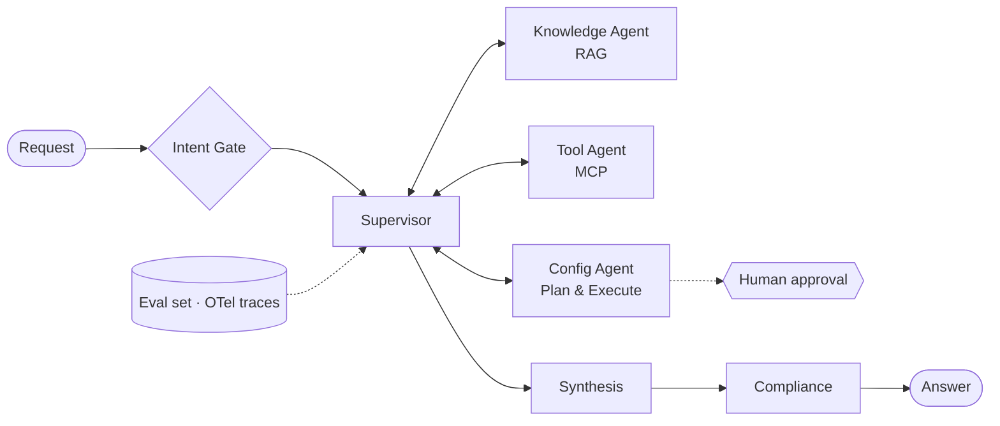

<div align="center">


<a href="https://www.linkedin.com/in/jiale-chen-532856410/"></a>


</div>

### `$ cat agent.manifest.yaml`

```yaml
agent: jiale-chen
role: AI Agent Engineer @ OpenDesign
based_in: Shenzhen, China
motto: "Do the hard and right thing."

runtime:                       # what I build
  - production multi-agent systems, 0 → 1 → prod
  - workflow orchestration with HITL gates, checkpoints, replay
  - RAG · MCP tool ecosystems · agent eval · observability

memory:                        # where I come from
  - BitKernel: Senior SDE / Platform Architect, promoted twice
  - Huawei 2012 Labs: network chip co-optimization
  - IEEE RTSS 2022 (CCF-A), first author

guardrails:                    # how I work
  - deterministic orchestration around non-deterministic models
  - every agent run is traceable, evaluable and replayable
  - measure quality and cost before calling it done
```

### 🧩 What a typical system of mine looks like



### 🚀 Selected work

| Project | What I built | Result |
|---|---|---|
| **Novel-to-Video AIGC Agent Platform** | 6 stage-expert agents behind a deterministic workflow with 4 HITL gates · manifest-driven Agent Runtime · multi-provider media task runtime | 1,500+ AI short dramas · **~90% cost down** |
| **GooseOTT Multi-Agent Support** | Supervisor multi-agent · RAG (BGE-M3 + Milvus + rerank) · 32 MCP tools · golden-set eval used as a CI gate | 20K+ requests/month · **97% accuracy** |
| **RDNS: Reliable DNS (DNS + DHT)** | Cross-platform C++ engine · DHT nodes · multi-level cache · lock-free queue | 15M resolutions/day · **99.9% success** |
| **SPOT: Network Chip Design Optimization** | HW/SW modeling · NSGA-II / MOTS search · PPA evaluation | **−20.6% latency, −23.7% power** |

### 🛠️ Toolbox

<p>
  
</p>


<sub>🎓 M.S. Shenzhen University × Huawei joint program · B.S. Guangzhou University (ranked 1/102)</sub>
